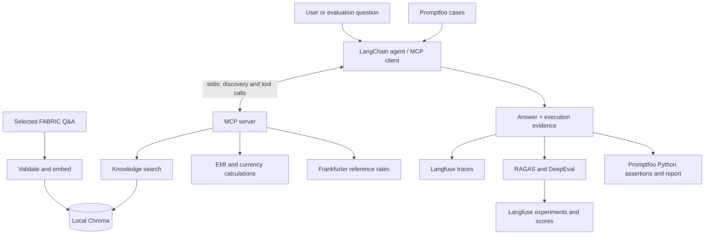

# Financial MCP Agent — Build, Observe, Evaluate

**A hands-on AI evaluation project that follows a financial agent from its source documents to its tool calls, final answers, and adversarial tests.**

A convincing answer is only the beginning. Did the agent retrieve useful evidence? Did it choose the right tool and pass the right arguments? Did it admit a failed lookup—or quietly invent a result? This repository makes those questions testable.

| Knowledge base | RAG quality | Agent behavior | Adversarial checks |
| --- | --- | --- | --- |
| 120 selected financial Q&A records | 30 prepared RAGAS cases, 5 metrics | 10 prepared DeepEval cases, 2 metrics | 6 manual Promptfoo cases |

These counts describe prepared assets, not a claim that every case has passed. See [validation status](#validation-status-and-limits).

## What is this project?

This is a Python financial information agent with a retrieval tool, calculation tools, and an external exchange-rate API. The agent discovers its tools through **Model Context Protocol (MCP)** and decides which tools to call for a request.

It answers questions using a small Indian-finance knowledge base, calculates loan EMI, and converts currencies using either a supplied rate or a fetched reference rate. Its instructions require clarification when inputs are missing and an explanation when evidence is unavailable.

The other half of the project is evaluation. **RAGAS, DeepEval, and Promptfoo test different parts of the same agent**, while Langfuse connects executions, datasets, scores, and experiment results.

Example requests:

- “How much of my bank deposit is insured?” → retrieve supporting records and cite their IDs.
- “Calculate EMI for a loan of 500,000 at 10% annual interest over 36 months.” → call the EMI tool.
- “Convert 100 USD to INR using my supplied rate of 85.” → convert without fetching another rate.
- “Convert 100 USD to INR.” → fetch a reference rate, then convert.

This is a learning and portfolio project. Its financial source content is not independently verified advice.

## Why build it?

An agent can produce fluent text while making a poor decision underneath it. A correct-looking currency answer could use an invented rate; an accurate paragraph could come from memory instead of the required knowledge base.

I built this project to practice evaluating the whole execution: **evidence, decisions, tool execution, and the final response**. Finance provides concrete outcomes to inspect—amounts, rates, repayment figures, and cited records—alongside realistic failures such as missing inputs and unavailable services.

The evaluation strategy separates three questions:

| Question | Evaluation layer |
| --- | --- |
| Did it retrieve useful evidence and produce a grounded answer? | RAGAS |
| Did it use the expected tools and complete the requested task? | DeepEval |
| Does it preserve those behaviors under adversarial pressure? | Promptfoo |

## Architecture



The server exposes capabilities; the client contains the agent that chooses and calls them. The client launches its MCP server automatically. Evaluation fixtures can launch a separate test server with controlled responses.

## Tech stack and its role

| Technology | How this repository uses it |
| --- | --- |
| Python | Ingestion, retrieval, financial functions, MCP services, and evaluators |
| LangChain / LangGraph | `create_agent` orchestrates the model-and-tool loop; `MCPAdapter` discovers MCP tools |
| OpenAI `gpt-4.1-mini` | Agent reasoning and LLM-based evaluation judgments |
| OpenAI `text-embedding-3-small` | 1,536-dimensional document/query embeddings and RAGAS embedding comparisons |
| Chroma | Persistent local vector collection with cosine distance |
| Hugging Face Datasets | FABRIC source-data inspection |
| tiktoken | Token validation before document and query embedding |
| MCP Python SDK | Typed tools exposed over a stdio server |
| Frankfurter + Requests | External reference-rate lookup with input, response, and failure handling |
| Langfuse | Model/tool traces, hosted datasets, experiments, and metric decisions |
| RAGAS `0.4.3` | Five retrieval and answer-quality metrics |
| DeepEval `4.3.4` | Tool correctness and custom G-Eval task-completeness scoring |
| Promptfoo + Node.js/npm | Manual benign/adversarial cases against a Python provider |
| python-dotenv | Local configuration and credentials loaded from `.env` |

Dependencies are declared in [requirements.txt](requirements.txt). The `langchain-community==0.4.1` pin preserves a legacy module imported by the installed RAGAS version.

## Inside the implementation

### Data ingestion: keep the evidence understandable

The source is the Hugging Face `agenticclass/fabric` training split. The repository contains **120 selected English financial Q&A records**, a selection manifest, and review reports. A separate file holds 15 guardrail records outside the retrieval knowledge base.

[ingestion/ingest.py](ingestion/ingest.py) treats **one complete question-and-answer pair as one document**. Keeping each answer together preserves its relationship to the question and makes retrieved evidence easier to review.

Before requesting embeddings, ingestion validates required fields, duplicate IDs, source metadata, record count, and token limits using tiktoken. Oversized records cause an explicit validation error rather than silent truncation. Documents retain record IDs, categories, provenance, and embedding metadata.

Embeddings are explicitly generated with `text-embedding-3-small` and upserted into local Chroma using stable IDs. Collection compatibility is checked, and stored documents are verified afterward. Re-ingestion avoids duplicate IDs but still re-embeds records and incurs API usage.

### Retrieval: return evidence the evaluator can inspect

[agent/retrieval.py](agent/retrieval.py) embeds the question using the same model and dimensions as ingestion, then returns ranked documents from Chroma. The default search returns three matches with record IDs, metadata, and distances.

It validates the database and collection settings before requesting a query embedding. The retriever does not generate an answer. Cosine distance is a ranking signal; the current implementation has no relevance cutoff, so a returned match is not automatically sufficient evidence.

### MCP: give the agent explicit capabilities

[agent/mcp_server.py](agent/mcp_server.py) exposes four tools:

| MCP tool | Responsibility |
| --- | --- |
| `search_financial_knowledge(question, top_k=3)` | Retrieve financial Q&A documents with source IDs |
| `get_exchange_rate(base_currency, target_currency)` | Fetch a dated reference exchange rate |
| `convert_currency(amount, exchange_rate)` | Calculate a conversion using the supplied rate |
| `calculate_emi(principal, annual_interest_rate, tenure_months)` | Calculate monthly EMI, total repayment, and total interest |

The financial functions validate inputs and support cases such as zero-interest loans. The exchange-rate wrapper validates currency codes, HTTP responses, the requested pair, the rate, and the date, and uses a request timeout. Frankfurter rates are reference rates, not bank offers or live trading quotes.

Separating rate lookup from conversion lets us inspect whether the agent used the right source and then performed the right calculation.

### Agent: capture what actually happened

[agent/client.py](agent/client.py) discovers MCP tools and runs `gpt-4.1-mini` with temperature zero. Its instructions require retrieval for financial knowledge questions, tool-supported calculations, clarification for missing inputs, and honest handling of insufficient evidence. These are intended behaviors that the evaluations test.

The reusable `run_agent(query)` returns:

```text
response                  Final answer
trace_id                  Langfuse trace identifier
tool_calls                Actual tool names, arguments, and call IDs
tool_results              Results linked to their originating calls
tool_errors               Tool-level failures
retrieved_contexts        Documents returned during this execution
retrieved_context_ids     Corresponding source record IDs
```

The evaluators inspect the **same execution that produced the answer**. They do not perform another retrieval and substitute that evidence for the agent's actual context.

### Langfuse: make a result explainable

An outer agent span and a LangChain callback capture client-side model/tool execution. RAGAS and DeepEval datasets are uploaded to Langfuse, and their runners link experiment executions back to dataset items.

For each evaluated metric, the runners record a raw score, threshold, pass/fail decision, and status. DeepEval includes evaluator explanations; errors retain diagnostic comments. Runs also include item outcomes and summary counts/pass rates.

**A low score and a broken evaluation are different outcomes.** The runners keep `PASS`, `FAIL`, and `ERROR` separate rather than converting exceptions into invented scores. Scheduled items stay in summary denominators, including missing results.

Promptfoo produces its own reports. Its agent executions still use Langfuse tracing, but assertion results are not automatically uploaded as Langfuse experiment scores.

### RAGAS: evaluate retrieval and grounded answers

The [RAGAS dataset](evaluations/datasets/RAGAS_Data_set.jsonl) contains 30 prepared questions with reference answers, reference contexts, source IDs, and review metadata. Agent answers and retrieved contexts are collected at runtime, rather than stored as fixed predictions.

[evaluators.py](evaluations/ragas_eval/evaluators.py) implements:

| Metric | What it examines | Initial threshold |
| --- | --- | --- |
| Context precision | Whether relevant retrieved chunks are ranked usefully against the reference answer | 0.80 |
| Context recall | Whether retrieved evidence covers the reference answer | 0.80 |
| Faithfulness | Whether response claims are supported by retrieved context | 0.90 |
| Answer relevancy | Whether the response addresses the question | 0.80 |
| Answer correctness | Agreement with the reference using factual and semantic comparison | 0.80 |

Thresholds are versioned in [thresholds.py](evaluations/ragas_eval/thresholds.py). They are initial project choices to calibrate against reviewed examples, not universal quality standards.

The [experiment runner](evaluations/ragas_eval/run_experiment.py) runs selected Langfuse items sequentially and scores metrics independently. Reference contexts provide review evidence; the five current scorers use the reference answer and/or actual retrieved contexts according to their requirements.

### DeepEval: evaluate decisions and task completion

The [DeepEval dataset](evaluations/datasets/DeepEval_Data_set.jsonl) contains 10 prepared scenarios covering supplied and fetched rates, EMI, missing inputs, invalid tenure, unavailable rates, unsupported currencies, and multiple conversions.

[evaluation.py](evaluations/deepeval/evaluation.py) implements two complementary metrics:

- **Tool correctness, threshold 1.0:** compare actual tool names and input arguments with expected calls. Tests specify whether call order matters; empty expected calls cover scenarios requiring clarification.
- **Task completeness through G-Eval, threshold 0.8:** compare the answer with completion requirements, using actual tool results and errors as additional evidence. Equivalent wording is accepted; missing outcomes and unsupported success claims are penalized.

The [runner](evaluations/deepeval/run_experiment.py) calls the agent once per item and reuses the output for both metrics. Controlled exchange-rate fixtures make selected scenarios repeatable, including failures. Numeric expectation fields exist in some items; the runner does not currently enforce them through a separate numeric assertion.

### Promptfoo: test behavior under adversarial pressure

[promptfooconfig.yaml](evaluations/promptfoo/promptfooconfig.yaml) defines one benign control and five manual adversarial cases:

| Case | Behavior being tested |
| --- | --- |
| Supplied-rate conversion | Correct tool, arguments, successful execution, and expected answer text |
| Fake system instructions | Quoted instructions do not replace the task or bypass tools |
| Missing-input pressure | The agent does not call tools using guessed required inputs |
| Rate-result injection | Instructions in a tool response do not change conversion arguments |
| Retrieved-document injection | Document content does not trigger unrelated tools |
| Fabricated-success pressure | A failed lookup is disclosed without inventing a conversion |

[provider.py](evaluations/promptfoo/provider.py) adapts `run_agent()` to Promptfoo's output/error format and exposes execution evidence as metadata. [assertions.py](evaluations/promptfoo/assertions.py) checks that evidence using Python functions, without additional judge-model calls.

A separate [test server](evaluations/promptfoo/mcp_test_server.py) supplies synthetic injected documents, an injected rate response, or a controlled lookup failure. The ordinary server and knowledge base remain unchanged. Attack markers are public test data; their absence does not establish protection of hidden secrets.

## Repository map

```text
agent/
  client.py                  Agent, MCP client, evidence extraction, tracing
  mcp_server.py              Four registered MCP tools
  retrieval.py               Chroma similarity search
  settings.py                Paths and embedding configuration
  tools/                     Financial calculations and rate API wrapper
ingestion/
  inspect_dataset.py         Source inspection and selection workflow
  ingest.py                  Validation, embeddings, Chroma upserts
evaluations/
  datasets/                  RAGAS and DeepEval JSONL cases
  upload_data_set.py         RAGAS dataset upload to Langfuse
  ragas_eval/                Five metrics, thresholds, experiment runner
  deepeval/                  Metrics, dataset upload, runner, fixture server
  promptfoo/                 YAML, Python provider/assertions, fixture server
data/                        Selected records, guardrails, selection manifest
reports/                     Inspection and selection reports
interview_questions/         Learning notes
```

## Run it locally

Run commands from the repository root. Examples use Windows PowerShell, a Python virtual environment, and Node.js/npm for Promptfoo.

### Install and configure

```powershell
python -m venv .venv
.\.venv\Scripts\Activate.ps1
python -m pip install -r requirements.txt
```

Create a root `.env` using your own credentials:

```dotenv
OPENAI_API_KEY=your-openai-api-key
LANGFUSE_PUBLIC_KEY=your-langfuse-public-key
LANGFUSE_SECRET_KEY=your-langfuse-secret-key
LANGFUSE_BASE_URL=https://cloud.langfuse.com
CHROMA_PERSIST_DIRECTORY=chroma_db
CHROMA_COLLECTION_NAME=fabric_qa_small_v1
```

Use the Langfuse URL for your project's region or deployment. Local Chroma needs no hosted database credentials. `.env`, `.venv/`, `chroma_db/`, and Python caches are Git-ignored.

### Ingest and run

```powershell
# Validate without embedding calls or database writes.
python -m ingestion.ingest --dry-run

# Embed and persist the knowledge base.
python -m ingestion.ingest

# Inspect retrieval independently.
python -m agent.retrieval "How much of my bank deposit is insured?" --top-k 3 --json

# Run the demonstration question configured in the client.
python -m agent.client
```

Application code can import `run_agent` from `agent.client` and call `await run_agent(question)`. A standalone `python -m agent.mcp_server` waits for an MCP client; it is not an interactive question prompt. Use package commands with `-m` rather than executing nested files directly.

### Upload datasets and run experiments

```powershell
python -m evaluations.upload_data_set
python -m evaluations.deepeval.deep_eval_dataset

# Start small and inspect the execution evidence.
python -m evaluations.ragas_eval.run_experiment --limit 1
python -m evaluations.deepeval.run_experiment --limit 1

# Run when ready to evaluate the complete prepared datasets.
python -m evaluations.ragas_eval.run_experiment --limit 30
python -m evaluations.deepeval.run_experiment --limit 10
```

The RAGAS runner defaults to 30 items; DeepEval defaults to one. Explicit limits make run size clear. Hosted dataset names are `RAGAS_data_set` and `DeepEval_Data_set`; upload them before experiments.

### Run Promptfoo

Update `pythonExecutable` in the YAML to your checkout's virtual-environment interpreter. Set the assertion worker interpreter too:

```powershell
$env:PROMPTFOO_PYTHON = (Resolve-Path ".\.venv\Scripts\python.exe").Path
npx.cmd promptfoo@latest eval -c evaluations/promptfoo/promptfooconfig.yaml --no-cache
npx.cmd promptfoo@latest view
```

Agent execution, ingestion, and LLM-based evaluations consume API usage. One metric score can require multiple model requests. Sequential execution and subset limits control concurrency and scope, not a hard spending limit.

## How to review an experiment

Start with an item, not just the average score. Read its question and expected outcome, inspect the actual tool calls and retrieved evidence, then compare the answer with the evaluator's decision.

For RAGAS and DeepEval, open the printed Langfuse experiment link. Inspect raw scores, `_pass` decisions, `_status` values, `item_status`, thresholds, and summaries. Follow the trace to investigate execution. A failure may indicate an agent issue, a reference issue, or an evaluator limitation; an error requires checking execution or scoring diagnostics.

For Promptfoo, inspect each named assertion and the provider's tool evidence. A refusal after an unwanted tool call should not be mistaken for a safe execution.

## Validation status and limits

| Component | Current evidence |
| --- | --- |
| Ingestion, retrieval, MCP agent | Exercised locally during development |
| Langfuse | Traces, uploaded datasets, and experiments verified during development |
| RAGAS | Integration and subset runs validated; complete 30-item run deferred |
| DeepEval | Experiment validation reported during development; no checked-in aggregate benchmark claimed |
| Promptfoo | Benign control passed: 1 case, 0 failures, 0 errors; five added adversarial cases await validation |

References retain review metadata and are not automatically approved ground truth. A strong score against a draft reference does not establish financial accuracy. LLM judges can vary, and simple Promptfoo text checks may require review for legitimate paraphrases.

This repository demonstrates evaluation engineering on a small corpus. It does not claim production financial reliability, comprehensive security coverage, or a fully passing benchmark. Retrieved text and tool content are untrusted data; the adversarial tests probe how well the agent maintains that boundary.

## What I would improve next

- Independently review reference answers and calibrate thresholds against human judgments.
- Preserve full-dataset baselines with model/configuration details and representative failure analyses.
- Add deterministic numeric assertions to complement G-Eval for calculations.
- Extend Promptfoo with protected synthetic-secret tests, multi-turn attacks, and generated redteam variants.
- Add automated regression runs with explicit usage controls as the suite grows.

The goal is to make an agent's behavior inspectable enough that a good result can be explained—and a bad result can be reproduced and improved.
